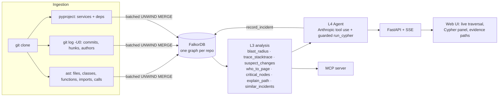

# Blast Radius

**A graph-powered incident agent on FalkorDB.** Paste a stack trace — or name a service, file or function — and Blast Radius walks a FalkorDB graph of your codebase, ownership and change history to tell you:

1. **what breaks** (reverse-dependency blast radius),
2. **which recent change most likely caused it, and who to page**,
3. **which past incidents look like this one** (graph memory),

and it shows **the exact graph path behind every claim**, live, while the agent runs. A claim with no path is dropped before you ever see it.

> Built for **Graph Hacks: Context for AI Agents** (WeMakeDevs × FalkorDB).
> **Live demo:** _add URL after deploying (see [`docs/DEPLOY.md`](docs/DEPLOY.md))_ · **Demo video:** _add link_ · **Blog:** [`docs/BLOG.md`](docs/BLOG.md) · **Queries & algorithms used:** [`docs/queries.cypher`](docs/queries.cypher)
> Tracks: **01 Agents That Act on Connected Data** (primary) · **03 Company Brain** (who owns / who knows what) · **02 Agent Memory** (incidents persist in the graph across sessions).


## Why a graph?

~70% of outages come from changes to a live system ([Google SRE book](https://sre.google/sre-book/introduction/)). Answering "what did this change touch, who owns it, and has this happened before?" is a *multi-hop* question across code structure, git history and people. Blast Radius makes that one traversal:

```
Commit ─MODIFIED→ File ←IMPORTS─ File ←CONTAINS─ Service ←DEPENDS_ON─ Service
   ↑AUTHORED          ↑AFFECTED                       ↑OWNS
 Person            Incident ─CAUSED_BY→ Commit    Person
```

The agent does not guess: every tool is a deterministic FalkorDB query, the LLM only routes between tools and narrates, and the answer is validated against the paths the graph actually returned.

## Architecture



| Layer | Folder | What it does |
|---|---|---|
| L1 Ingestion | `blast/ingest/` | `python -m blast.ingest.cli <url\|path>`: ast + git + pyproject → graph. Idempotent (`MERGE`), ~5 s for OpenTelemetry-Python |
| L2 Graph model | `blast/graph/` | schema, indexes, FalkorDB client wrapper that records every query's Cypher + latency |
| L3 Analysis | `blast/analysis/` | deterministic, LLM-free functions; each returns structured data **+ evidence paths + the Cypher it ran** |
| L4 Agent | `blast/agent/` | Anthropic tool-use loop; guarded read-only `run_cypher`; claims verified against real paths |
| L5 Memory | `blast/memory/` | every investigation is written back as an `Incident` and recalled by later ones |
| L6 API | `blast/api/` | FastAPI, SSE event stream, replay endpoint, OpenAPI at `/docs` |
| L7 UI | `web/` | no-build static app: live traversal animation, "under the hood" Cypher panel, algorithm lenses |
| MCP | `blast/mcp_server.py` | same tools for Claude Desktop / Claude Code |

### Graph schema

Nodes: `Repo, Service (in-repo package), File, Class, Function, Package (external dep), Person, Commit, Incident`.
Edges: `CONTAINS, DEFINES, IMPORTS, CALLS{confidence}, DEPENDS_ON, OWNS{score,source}, AUTHORED, MODIFIED{adds,dels}, AFFECTED, CAUSED_BY{confidence}, RESOLVED_BY, SIMILAR_TO{score}`.
Live schema: UI → **Schema**, or `GET /api/graph/otel/schema`. Details and rationale: [`docs/DECISIONS.md`](docs/DECISIONS.md), [`docs/ARCHITECTURE.md`](docs/ARCHITECTURE.md).

Honesty notes baked into the model: ownership is **inferred** from recency-weighted commits (OpenTelemetry's CODEOWNERS is a single catch-all team); `CALLS` edges are best-effort static resolution; function-level `MODIFIED` edges come from `git blame` at HEAD (which in-window commit wrote each function's current lines), file-level ones from `git log`; incidents are **real** fix commits (`fix|revert|regression…`) with `CAUSED_BY` found by `git blame` on the removed lines (SZZ-lite). Nothing is fabricated.

## How FalkorDB is used

* **One graph per repo** in a single FalkorDB instance (`GRAPH.LIST`; repo switcher in the UI). Indexes on every key property.
* **Bulk load:** batched `UNWIND $rows AS r MERGE …` (1k rows/batch).
* **Reads go through `GRAPH.RO_QUERY`** (agent `run_cypher` can't write even if guards fail).
* **Multi-hop traversals**, e.g. blast radius of a file: `MATCH p=(x:File)-[:IMPORTS*1..3]->(t:File {path:$k}) RETURN …`, then `(x:Service)-[:DEPENDS_ON*1..3]->(t:Service)`.
* **Path functions:** `shortestPath((a)-[:IMPORTS|CALLS|DEPENDS_ON|DEFINES|CONTAINS*..6]->(b))` for `explain_path` and stack-frame linking.
* **Native algorithms:** `algo.pageRank('Service','DEPENDS_ON')` (single points of failure, node size), `algo.betweenness`, `algo.labelPropagation` (communities lens).
* **Change attribution:** `(Commit)-[:MODIFIED]->(File|Function)` scored by recency × churn × graph proximity; `(Incident)-[:CAUSED_BY]->(Commit)`.
* **Latency is shown, not hidden:** every query's server-side `run_time_ms` streams to the "Under the hood" panel with a running p50/p95.

## Run it

Requirements: Docker, an `ANTHROPIC_API_KEY` (only needed for the LLM-agent mode; the deterministic pipeline needs none).

```bash
cp .env.example .env            # set ANTHROPIC_API_KEY (optional)
docker compose up --build -d    # FalkorDB :6379 (Browser :3000), API+UI :8000
docker compose run --rm ingest  # clones opentelemetry-python @ 2fa016b2 (pinned) and builds the 'otel' graph (~1 min incl. clone; ingest itself ~5 s)
open http://localhost:8000
```

Local dev: `python -m venv .venv && pip install -r requirements-dev.txt`, `docker run -p 6379:6379 -p 3000:3000 falkordb/falkordb`,
`python -m blast.ingest.cli data/repos/otel --graph otel`, `uvicorn blast.api.main:app`, `make test`.

CLI: `python -m blast.cli investigate "opentelemetry-exporter-otlp-proto-grpc"` (add `--llm` for the agent).
MCP: `{"mcpServers":{"blast-radius":{"command":"python","args":["-m","blast.mcp_server"]}}}`.

### Demo scenarios (golden-tested in `tests/test_golden_scenarios.py`)

1. **2 AM, metrics stopped exporting** — paste a real traceback through the periodic metric reader → frames map to `Function` nodes, origin = `SynchronousMeasurementConsumer.collect`, blast radius = 14 services / 25 files, top suspect = `66a7c08f "Fix metrics collection timeout…"`, recalls its own fix as a past incident.
2. **Service down:** `opentelemetry-exporter-otlp-proto-grpc` → dependents, suspects `f36c1288` / `8acde049`, who to page.
3. **I'm changing `sdk/metrics/_internal/view.py`** → every importer and every dependent package, plus recurring-defect history.
4. **Memory:** run (1), restart FalkorDB, investigate `measurement_consumer.py` → the earlier incident is recalled with the shared files.

### Cost control

The LLM loop uses Claude Haiku 4.5 with prompt caching, ≤9 turns, compact tool results (~2–3¢/run), and a persisted spend ledger that falls back to the zero-cost deterministic pipeline at `SPEND_LIMIT_USD`. Recorded real runs (`data/replays/`) can be replayed without any LLM or DB: `/?replay=scenario3`.

## Tests

`make test` → 39 tests (guard, ingestion idempotence/indexes, every analysis function on a fixture graph, golden scenarios, agent claim verification) + Playwright end-to-end (`tests/e2e`).

## Limitations / next steps

Python only (tree-sitter would add languages); CALLS is static and best-effort; ownership is inferred, not authoritative; similarity is Jaccard over affected files (embedding rerank is a natural extension); FalkorDB Cloud free tier has no persistence, so the hosted demo ships a re-seed script and recorded replays.

## AI-use disclosure

Blast Radius was built with Claude Code (Claude Sonnet) as a pair-programmer, including research subagents and independent "judge" subagents used to evaluate the product (reports in `docs/eval/`). The product itself uses Claude Haiku 4.5 at run time only when the **LLM agent** toggle is on; the default pipeline is deterministic graph queries. All numbers shown in the UI come from live FalkorDB queries; the decision log is in `docs/DECISIONS.md`.
