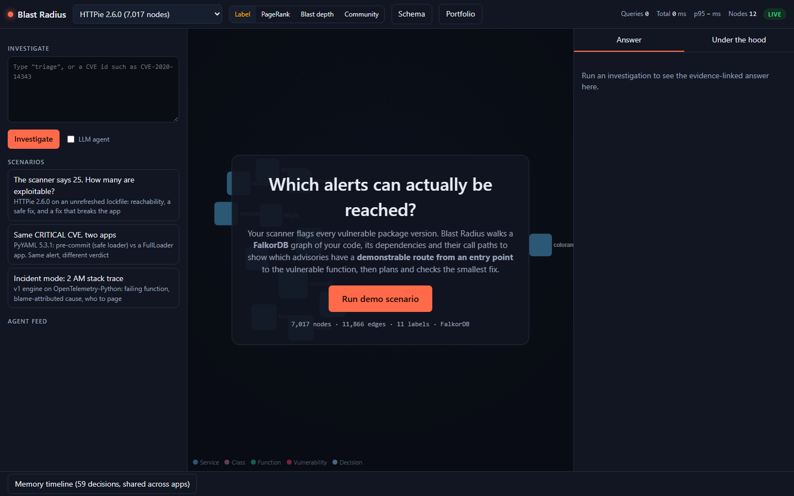
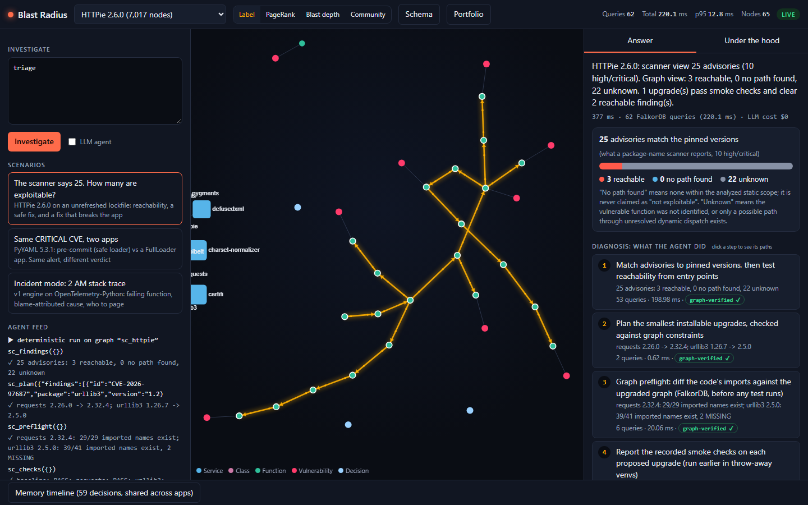
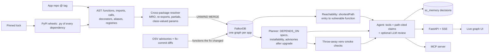

# Blast Radius: Reachability-to-Repair

**A graph-native security agent on FalkorDB.** Your scanner flags every vulnerable package version. Blast Radius builds a FalkorDB graph of your application, its pinned dependencies and their call paths, then answers the questions a scanner cannot:

1. **Which of these alerts can actually be reached** from an entry point of my app, and through which exact call path?
2. **What is the smallest upgrade plan** that clears the reachable ones without violating any dependency constraint?
3. **Does the proposed fix still run?** (smoke checks in a throw-away virtualenv, reported separately from the "fixed" claim)
4. **Have we decided this before?** Verdicts persist in the graph and are recalled across apps.

> Built for **Graph Hacks: Context for AI Agents** (WeMakeDevs x FalkorDB). Track 01 *Agents That Act on Connected Data* (primary), Track 03 *Company Brain* (ownership of code on the path), Track 02 *Agent Memory* (decisions persist and are recalled across apps).
> **Live demo:** _add URL after deploying, see [`docs/DEPLOY.md`](docs/DEPLOY.md)_ · **Demo video:** _add link_ · **Blog:** [`docs/BLOG.md`](docs/BLOG.md) · **Queries and algorithms used:** [`docs/queries.cypher`](docs/queries.cypher) · **Ground truth and method:** [`docs/eval/ground-truth.md`](docs/eval/ground-truth.md)




## The moment

*The same CRITICAL alert, two apps.* PyYAML 5.3.1 has CVE-2020-14343 (CVSS 9.8, arbitrary code execution through unsafe loaders). Both **pre-commit 2.9.0** and a small app that calls `yaml.load(f, Loader=yaml.FullLoader)` pin it, so every scanner flags both. Blast Radius says:

* **the FullLoader app: REACHABLE**, `main -> load_settings -> FullConstructor.construct_python_object_new` (2 hops), and plans `PyYAML 5.3.1 -> 6.0` whose smoke check passes;
* **pre-commit: NO PATH FOUND**, because the graph shows it passes only `SafeLoader`/`CSafeLoader` (via `functools.partial(yaml.load, Loader=...)`), whose class hierarchy never registers the vulnerable handlers. It still shows what it *did* reach in the same file, and does **not** claim "not exploitable".

On **HTTPie 2.6.0** it finds 3 reachable advisories out of 25 (and declares none safe: the other 22 are unknown, 5 of them with a possible path through dynamic dispatch), plans `requests 2.26.0 -> 2.32.4` (clears two reachable CVEs, checks pass) and **refuses** to recommend `urllib3 -> 2.x` because it breaks the app (`ImportError: DEFAULT_CIPHERS`), a result the graph predicts (a name HTTPie imports no longer exists in the upgraded graph) and the smoke check then confirms. After the passing upgrade the analysis is re-run on the upgraded graph: for HTTPie 3 reachable become 1 (the urllib3 one, which needs an app change); for cookiecutter 6 become 0.

## Results (real queries, real data)

<!--BENCH-->
| App (pinned lock) | Scanner alerts | of which high/critical | Reachable | No path found | Unknown | Upgrades planned | Pass smoke checks | Reachable alerts cleared by passing upgrades |
|---|---|---|---|---|---|---|---|---|
| HTTPie 2.6.0 | 25 | 10 | 3 (0 via handler table) | 0 | 22 (5 possible path) | 2 | 1 | 2 |
| cookiecutter 1.7.3 | 24 | 9 | 6 (3 via handler table) | 0 | 18 (7 possible path) | 3 | 3 | 6 |
| pre-commit 2.9.0 | 9 | 5 | 0 (0 via handler table) | 1 | 8 (0 possible path) | 0 | 0 | 0 |
| yamlfull (positive control) | 1 | 1 | 1 (0 via handler table) | 0 | 0 (0 possible path) | 1 | 1 | 1 |

Total: 59 alerts, 10 reachable (17%): 7 are direct call paths and 3 reach a function only through a handler table (available to templates; exploitation needs a template that calls it).
<!--/BENCH-->

* Alerts come from [OSV.dev](https://osv.dev) for the pinned versions, the same set a package-name scanner reports. Apps are real OSS projects at a real tag with the dependency versions an unrefreshed lock would pin (documented in `data/apps/*.pins.txt`). `yamlfull` is a positive control, not a real project.
* **"Reachable"** = a call path exists from an entry point to a function that the advisory's **fix commit** changed. That mapping is an inference (OSV does not publish vulnerable functions); it is labelled everywhere. Reachable is **not** the same as exploitable: preconditions (configuration, attacker input) are out of scope.
* **"No path found"** is only issued with positive evidence: a vulnerable function was identified, the app demonstrably reaches *other* code in the same file, and no path (not even through unresolved dispatch) reaches the vulnerable one. It is never reported as "not exploitable". **"Unknown"** = the vulnerable function could not be identified (a data file, a shell template), the analyzed code never reaches the file (subprocess, streaming and plugin boundaries are blind spots), or only a *possible* path exists through unresolved dynamic dispatch.
* Method, hand-verified verdicts and known failure modes: [`docs/eval/ground-truth.md`](docs/eval/ground-truth.md).

## Why FalkorDB is essential here

Remove the graph and the product loses its core, not its chart:

| Capability | How the graph does it |
|---|---|
| Reachability | `shortestPath((entry:Function {entry:true})-[:CALLS*..25]->(vuln:Function))` over thousands of functions across the app **and 10+ third-party packages**. One query per advisory, about a millisecond. |
| Dynamic dispatch a plain call graph misses | The resolver adds call-site-sensitive edges for class-valued parameters (`yaml.load(f, Loader=SafeLoader)`), `functools.partial`, handlers registered on classes (`FullConstructor.add_multi_constructor`), handler tables (`jinja2.filters.FILTERS`) and mixin `super()`; classes are `EXTENDS` edges, so "does this loader inherit the vulnerable constructor?" is graph structure. |
| Upgrade planning | Version constraints live on `DEPENDS_ON {spec}` edges. The planner queries every dependent's specifier for a package, and re-queries after an upgrade changes them (e.g. `urllib3 2.x` is blocked by `requests<...` until `requests` is bumped). |
| Criticality | `algo.pageRank` / `betweenness` / `labelPropagation` over `DEPENDS_ON` (lens in the UI). |
| Memory | `Decision` nodes in a shared `sc_memory` graph; a verdict in one app is recalled when the same advisory appears in another. |
| Evidence | Every claim, step and action cites path ids returned by FalkorDB; the server drops any item whose paths or named CVE/commit ids are not in them. |

**A decision only the graph makes: the upgrade preflight.** For every planned upgrade the pipeline also builds the *upgraded* graph (`sc_<app>__up_<pkg>`). The agent then diffs the two in FalkorDB: it asks the current graph for every name the code imports from the package, and asks the upgraded graph which of those names still exist. For HTTPie, `urllib3 -> 2.5.0` is **rejected by the graph before any test runs** (`urllib3.util.ssl_.DEFAULT_CIPHERS`, imported by HTTPie, no longer exists), and the throw-away-venv check then confirms it. Reachability is evaluated over thousands of functions across several packages; version constraints, class hierarchy, dispatch edges, the portfolio join and cross-app decisions are all stored and queried as graph structure.

**What would degrade without FalkorDB** (honestly): a single verdict could be recomputed in an in-memory graph library; what could not be kept is the persistent multi-app store, the *two-graph* preflight diff, the cross-app Portfolio and Decision memory (`MATCH (d:Decision)-[:ABOUT]->(v)` across apps), the shared evidence the agent cites (path ids returned by the database), and the live Cypher/latency panel that is the product's explanation.

Every Cypher query, with its server-side latency, streams to the "Under the hood" panel.

## Architecture



| Layer | Folder |
|---|---|
| Supply-chain engine | `blast/supply/` (`dists`, `resolve`, `build`, `advisories`, `analysis`, `planner`, `verify`, `pipeline`, `agent`) |
| v1 incident engine (blast radius of a change, stack trace to suspect commit via `git blame`, owners, similar incidents) | `blast/ingest`, `blast/analysis`, `blast/memory` |
| Agent loop, guard, claim verification | `blast/agent/` |
| API / MCP / UI | `blast/api/`, `blast/mcp_server.py`, `web/` |

### Graph schema (supply mode)

Nodes: `Repo, Service (the app, or a pinned dependency with a version), File, Class, Function (entry flag), Vulnerability, Decision`.
Edges: `CONTAINS, DEFINES, CALLS {how}, EXTENDS, DEPENDS_ON {spec}, AFFECTED_BY {version}, VULNERABLE_IN {commit, source}, ABOUT`. Live schema: UI **Schema**, or `GET /api/graph/sc_httpie/schema`.

## Run it

```bash
cp .env.example .env            # ANTHROPIC_API_KEY is optional (only for the "LLM agent" toggle)
docker compose up --build -d    # FalkorDB :6379 (Browser :3000), API + UI :8000
docker compose run --rm ingest  # builds the supply graphs (downloads wheels, OSV advisories, fix diffs; a few minutes)
open http://localhost:8000
```

Local dev: `python -m venv .venv && pip install -r requirements-dev.txt`, `docker run -p 6379:6379 -p 3000:3000 falkordb/falkordb`,
`python -m blast.supply.pipeline httpie` (also `precommit`, `cookiecutter`, `yamlfull`; add `--no-checks` to skip the venv checks and keep recorded ones), `uvicorn blast.api.main:app`, `make test`.

CLI: `python -m blast.cli investigate triage --graph sc_httpie`. MCP: `{"mcpServers":{"blast-radius":{"command":"python","args":["-m","blast.mcp_server"]}}}`.
Recorded runs (no DB or LLM needed): `/?replay=supply-httpie`.

**What it does not do:** it does not execute fixes. Actions are drafts (lockfile diff, PR text, VEX-style statement). Smoke checks run the app's own entry points in a throw-away venv; they are **not** the app's full test suite.

### Cost control
Deterministic mode needs no LLM. The optional LLM review (Claude Haiku 4.5, prompt caching, capped turns, about 2-4 cents) re-reads the graph answer and attaches a supported/weak/unsupported verdict per step and action; a spend ledger falls back to deterministic mode at `SPEND_LIMIT_USD`.

## Tests
`make test`: unit tests for the guard, the resolver on a synthetic library (call-site sensitivity, partials, registries, mixins, no guessing), CVSS scoring, the planner (unblocking after an upgrade), golden tests on the real graphs (same CVE, two verdicts; HTTPie path; failed-check upgrade reported), claim/action verification, and a Playwright end-to-end flow.

## Limitations and next steps
Python only; static analysis (no runtime tracing; dynamic dispatch only in the patterns listed above); vulnerable function inferred from the fix diff (advisories without a Python fix diff are "unknown"); reachability is not exploitability; smoke checks are shallow. Next: runtime evidence (coverage traces) to upgrade "no path found", more ecosystems via tree-sitter, SBOM/VEX import and export.

## AI-use disclosure
Built with Claude Code (Claude Sonnet) as a pair-programmer, including research subagents and independent "judge" subagents used to evaluate the product (reports in `docs/eval/`). The optional LLM mode uses Claude Haiku 4.5 at run time. All numbers in the UI come from live FalkorDB queries or recorded smoke-check runs; the decision log is in [`docs/DECISIONS.md`](docs/DECISIONS.md).
